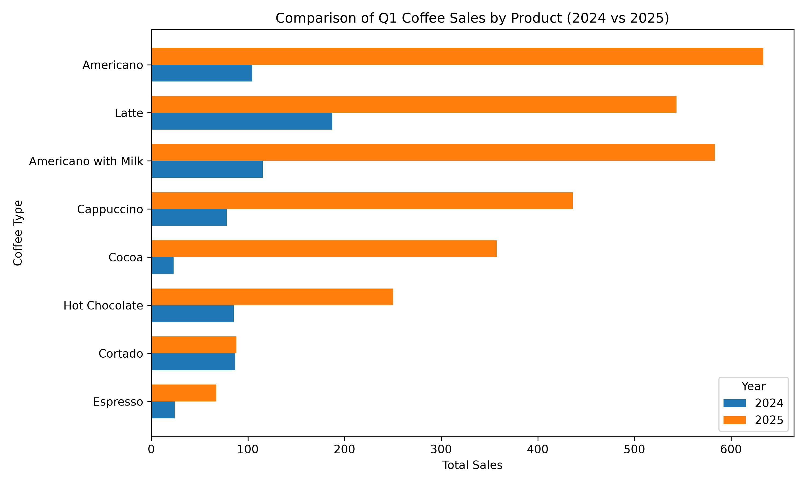
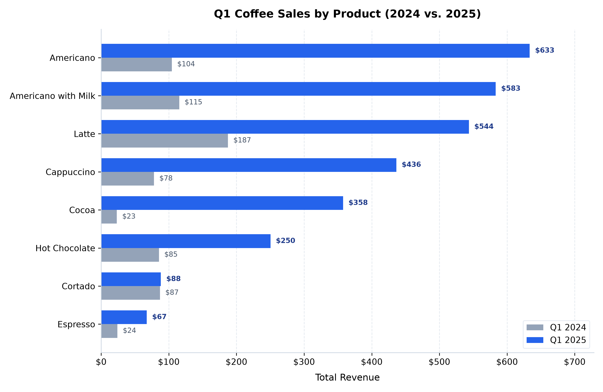

# Agentic Chart Generation

An interactive Jupyter notebook that uses a language model to generate a Matplotlib chart, critique the rendered image, and automatically produce a refined version.

The project demonstrates an agentic data-visualization workflow:

1. Load and prepare coffee sales data.
2. Generate Python plotting code from a natural-language instruction.
3. Execute the generated code and save a first chart.
4. Send the chart and original code to a vision-capable model for critique.
5. Generate revised code and save a polished chart.
6. Retry generated code once automatically when execution raises an exception.

## Example Results

### Initial chart



### Refined chart



The notebook also includes an end-to-end run that creates similarly named `drink_sales_v1.png` and `drink_sales_v2.png` images.

## Project Files

- `chart_generation.ipynb` - Main agentic chart-generation workflow.
- `utils.py` - Data loading, model clients, code extraction, execution, retry, and display helpers.
- `coffee_sales.csv` - Coffee transaction dataset.
- `requirements.txt` - Python dependencies.
- `chart_v1.png` / `chart_v2.png` - Initial and refined example charts.
- `drink_sales_v1.png` / `drink_sales_v2.png` - Additional generated chart example.

## Dataset

The CSV contains one coffee transaction per row with these columns:

| Column | Description |
| --- | --- |
| `date` | Transaction date |
| `time` | Transaction time |
| `cash_type` | Payment type, such as `card` or `cash` |
| `card` | Anonymous card identifier |
| `price` | Transaction price |
| `coffee_name` | Coffee or drink name |

The data loader adds `year`, `month`, and `quarter` columns derived from `date`.

## Setup

### 1. Create a virtual environment

```bash
python -m venv venv
```

Activate it on Windows:

```powershell
venv\Scripts\Activate.ps1
```

Or on macOS/Linux:

```bash
source venv/bin/activate
```

### 2. Install dependencies

```bash
python -m pip install --upgrade pip
pip install -r requirements.txt
```

### 3. Configure API credentials

Create a `.env` file in the project root:

```dotenv
GEMINI_API_KEY=your_gemini_api_key
# ANTHROPIC_API_KEY=your_anthropic_api_key
```

The default notebook configuration uses Gemini-compatible endpoints through `utils.py`. An Anthropic key is also supported for Claude model names.

Do not commit `.env`, API keys, or other credentials to GitHub.

## Run the Notebook

Start Jupyter Notebook:

```bash
jupyter notebook
```

Open `chart_generation.ipynb`, configure the model variables and chart instruction, and run the cells from top to bottom.

The end-to-end workflow accepts:

```python
run_workflow(
    dataset_path="coffee_sales.csv",
    user_instructions="Create a plot comparing Q1 coffee sales in 2024 and 2025.",
    generation_model="gemini-3.5-flash-lite",
    reflection_model="gemini-3.8-flash",
    image_basename="drink_sales",
)
```

It returns the first-draft code, reflection feedback, refined code, and generated image paths.

## Generated Outputs

For `image_basename="drink_sales"`, the workflow saves:

- `drink_sales_v1.png` - Initial generated chart
- `drink_sales_v2.png` - Refined chart after visual reflection

With the example instruction, the notebook compares quarterly coffee sales for 2024 and 2025.

## Notes

- Run the notebook from the project directory so relative paths resolve correctly.
- Model availability and exact model names depend on the configured provider.
- Generated code is executed inside the notebook process. Review model-generated code before running it on sensitive or production data.
